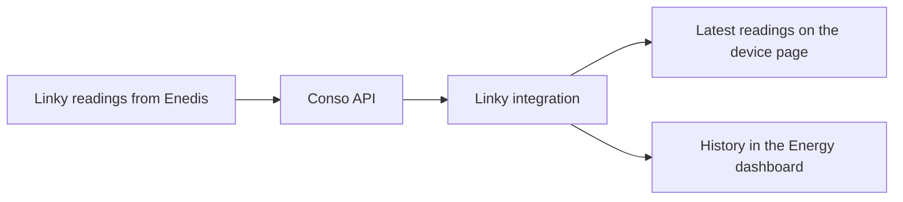

# Linky for Home Assistant

Bring the electricity measured by your Linky meter into Home Assistant's **Energy** dashboard. See how much you drew from the grid and, if your installation exports electricity, how much you sent back.

Home Assistant fetches readings through [Conso API](https://conso.boris.sh/), using
[Enedis Mesure synchrone V2](https://conso.boris.sh/migration-2026/). Enedis publishes
readings after the day they were measured, usually the following morning. A power
sensor shows the latest *published* measurement; it cannot track a live load.



## Connect a meter

You need Home Assistant **2026.11.1 or later** with Recorder enabled, a Linky
meter, and a [Conso API token](https://conso.boris.sh/). Enable data collection
with Enedis; hourly Energy charts also require access to the load curve.

1. [Open Linky in HACS](https://my.home-assistant.io/redirect/hacs_repository/?owner=guilhem&repository=hacs-linky&category=integration).
   You can also add `https://github.com/guilhem/hacs-linky` as an **Integration**
   from HACS's **Custom repositories** menu.
2. Download **Linky** and restart Home Assistant. For a manual installation,
   copy `custom_components/linky` into Home Assistant's `config/custom_components`
   directory and restart.
3. Open **Settings → Devices & services → Add integration → Linky** and enter
   the token. If the token covers multiple meters, select the meter you want.
   Run the setup again for each additional meter.
4. Open the Linky device page. **Daily consumption** displays the latest
   published day, and its `last_date` attribute tells you when it was measured.

Export sensors are disabled by default. If you feed electricity back into the
grid, enable them from the meter's entity list. Export measures what crosses
your meter towards the grid; it does not measure total solar generation.

## Add the meter to Energy

Open **Settings → Dashboards → Energy**. Under **Grid consumption**, select
`Linky {PRM} hourly consumption (kWh)`. If you export, select
`Linky {PRM} hourly production (kWh)` under **Return to grid**. Use the
corresponding **daily** statistic when hourly data is unavailable. Adding both
resolutions for the same meter and direction would count the electricity twice.
Use the `Europe/Paris` time zone in Home Assistant to align calendar days with Linky.

The device's latest daily reading is a snapshot; choose the named Linky
statistics for Energy history. Linky publishes energy quantities only. To show
a cost for an external statistic, Energy needs a separate cost statistic.

## Import an earlier period

Go to **Developer Tools → Actions** and select **Linky: Import historical data**.
Select the meter, enter the first day to include, then enter the first day to
exclude. For example, **2026-10-01** to **2026-10-08** imports the first seven
days of October. The end defaults to today in Paris. Import up to 30 days at a
time. A partial result reports missing or failed data; you can run the same
range again to pick up late or corrected readings without double counting.
An incomplete hour or an ambiguous timestamp at the clock change is left as a gap.

## If data is missing

| What you see | What to check |
| --- | --- |
| Home Assistant asks you to sign in again | Generate a Conso token for the same meter and enter it in the repair prompt. |
| Daily readings are visible but no hourly series appears | Check that Enedis load curve collection is enabled and that Conso can return interval data. You can use the daily statistic in Energy. |
| Today's readings are absent | Check the reading date on the sensor. Conso does not publish a live feed. |

## Develop

Use [uv](https://docs.astral.sh/uv/) with Python 3.14. After cloning the repository:

```sh
uv run --extra dev ruff check
uv run --extra dev ruff format --check
uv run --extra dev pytest
```

The tests use Home Assistant and simulated Conso responses. No meter or token is
required. Report issues with the Home Assistant version and the affected
feature; remove tokens and meter identifiers from logs before sharing them.

[MIT license](LICENSE)
