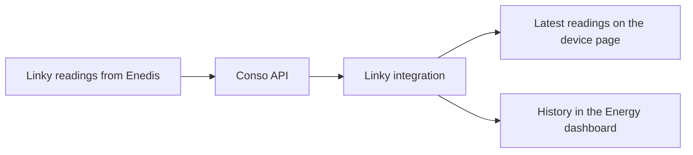

# Linky for Home Assistant

Bring the electricity measured by your Linky meter into Home Assistant's **Energy** dashboard. See how much you drew from the grid and, if your installation exports electricity, how much you sent back.

Home Assistant fetches readings through [Conso API](https://conso.boris.sh/), using
[Enedis Mesure synchrone V2](https://conso.boris.sh/migration-2026/). Enedis publishes
readings after the day they were measured, usually the following morning. Linky
refreshes once each morning in Paris time. A power sensor shows the latest
*published* interval; it cannot track a live load.



## Connect a meter

You need Home Assistant **2026.11.1 or later** with Recorder enabled, a Linky
meter, and a [Conso API token](https://conso.boris.sh/). Enable data collection
with Enedis; hourly Energy charts also require access to the load curve.

1. [Open Linky in HACS](https://my.home-assistant.io/redirect/hacs_repository/?owner=guilhem&repository=hacs-linky&category=integration).
   You can also add `https://github.com/guilhem/hacs-linky` as an **Integration**
   from HACS's **Custom repositories** menu.
2. Download **Linky** and restart Home Assistant. For a manual installation,
   copy `custom_components/linky` into Home Assistant's `config/custom_components`
   directory and restart.
3. Open **Settings → Devices & services → Add integration → Linky** and enter
   the token. If the token covers multiple meters, select the meter you want.
   Run the setup again for each additional meter. If the request budget was
   just initialized, wait 24 hours before submitting the token again.
4. After the next scheduled refresh, open the Linky device page.
   **Daily consumption** displays the latest published day. Its `last_date`
   attribute tells you when it was measured.

## Change a meter's settings

Open **Settings → Devices & services → Linky** and use the meter's menu:

- **Reconfigure** replaces the Conso token for this meter. Home Assistant
  verifies that the new token works for the same meter before saving it.
  Your entities, preferences, and Energy history stay in place.
- **Configure** controls grid export collection and **Daily totals only**.
  The default uses one consumption load-curve request to fill both hourly and
  daily Energy statistics. Choose **Daily totals only** if your meter does not
  have a load curve, and select the daily statistic in Energy. This mode
  does not update the average power sensor.
- Export collection is off for newly added meters. Enable it if you send
  electricity back to the grid. It uses one additional request per refresh.
  These settings also apply to historical imports. Existing Energy history is
  kept. The daily maximum apparent power sensor is no longer updated, because
  that measurement requires its own request.

Linky allows up to **three Conso requests per meter in any 24-hour period**,
including token checks, failed requests, and manual imports. Home Assistant
remembers this budget across restarts. Startup does not trigger a refresh.
The first time the budget is initialized, Linky waits 24 hours so any requests
from a previous version can age out. The scheduled morning refresh fills in
available readings from the previous seven days.
See [Conso's usage rules](https://conso.boris.sh/blocage-ip).

Export measures electricity sent to the grid. For the latest export readings
on the device page, also enable the export sensors in the meter's entity list.

## Add the meter to Energy

Open **Settings → Dashboards → Energy**. Under **Grid consumption**, select
`Linky {PRM} hourly consumption (kWh)`. If you export, select
`Linky {PRM} hourly production (kWh)` under **Return to grid**. Use the
corresponding **daily** statistic when hourly data is unavailable. Adding both
resolutions for the same meter and direction would count the electricity twice.
Use the `Europe/Paris` time zone in Home Assistant to align calendar days with Linky.

The device's latest daily reading is a snapshot; choose the named Linky
statistics for Energy history. Linky publishes energy quantities only. To show
a cost for an external statistic, Energy needs a separate cost statistic.

## Import an earlier period

Go to **Developer Tools → Actions** and select **Linky: Import historical data**.
Select the meter, enter the first day to include, then enter the first day to
exclude. For example, **2026-10-01** to **2026-10-08** imports the first seven
days of October. The end defaults to today in Paris. Import at most seven days
at a time, within the same request budget as the scheduled refresh. A partial
result reports missing or failed data. You can import the same dates again
without double counting once the oldest attempts are more than 24 hours old. Missing hours are left as
gaps, and a day is not added to the daily statistics until its load curve is
complete. For a large history, use the provider's
[Conso Downloader](https://github.com/bokub/conso-downloader).

## If data is missing

| What you see | What to check |
| --- | --- |
| Your token expired or you generated a replacement | Open the meter’s **Reconfigure** menu. If Home Assistant already opened a repair, you can also enter the new token there. |
| Daily readings are visible but no hourly series appears | Check that Enedis load curve collection is enabled and that Conso can return interval data. You can use the daily statistic in Energy. |
| Today's readings are absent | Check the reading date on the sensor. Conso does not publish a live feed. |

## Develop

Use [uv](https://docs.astral.sh/uv/) with Python 3.14. After cloning the repository:

```sh
uv run --extra dev ruff check
uv run --extra dev ruff format --check
uv run --extra dev pytest
```

The tests use Home Assistant and simulated Conso responses. No meter or token is
required. Report issues with the Home Assistant version and the affected
feature; remove tokens and meter identifiers from logs before sharing them.

[MIT license](LICENSE)
